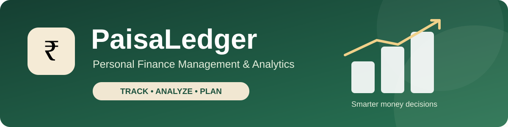
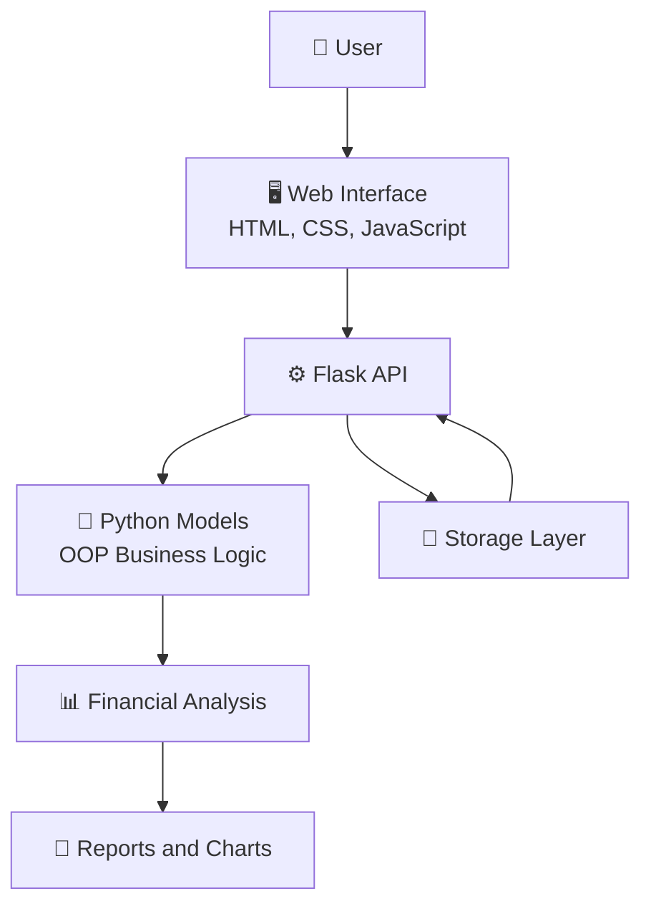
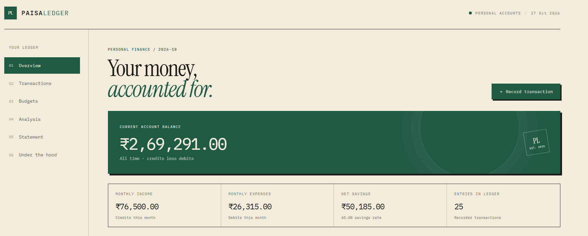
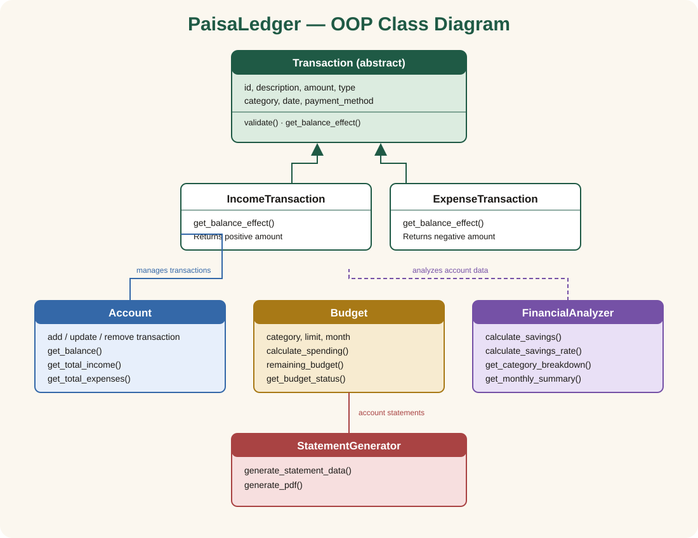
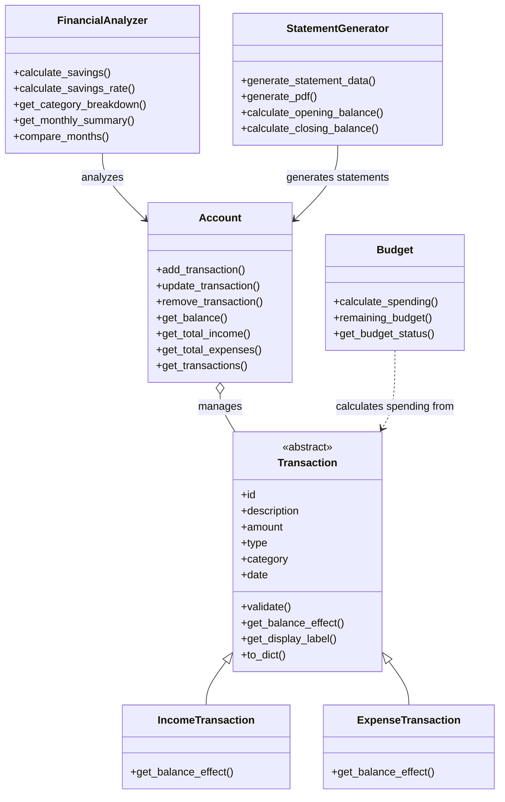

<div align="center">
  
</div>

<div align="center">

# 💰 PaisaLedger

### Personal Finance Management & Analytics System

A Python-based personal finance application for managing transactions, tracking budgets, and understanding financial habits through interactive charts and reports.


**Track your money. Understand your habits. Plan smarter.**

</div>

---
# PaisaLedger — Personal Finance Management & Analytics

A beginner-friendly college OOP mini project for recording income and expenses, understanding monthly spending, setting category budgets, and exporting a dated account statement. It uses Python and Flask on the server, plain HTML/CSS/JavaScript in the browser, and a local JSON file for demo data.

## Problem statement

People who track daily money in scattered notes cannot quickly see their balance, spending by category, or savings trend. PaisaLedger collects dated credits and debits in one small ledger and turns them into useful summaries. The project demonstrates how classes can represent transactions, accounts, budgets, analysis, and statements.

## Features

- Dashboard balance, current-month income, expenses, net savings, savings rate, and entry count, calculated from transactions.
- Add, edit, delete, and filter dated transactions. Newest entries appear first.
- Monthly category budgets, spending progress, remaining amount, and over-budget status.
- Monthly cash-flow and savings trends, category analysis, largest expense, average expenses, and previous-month comparison.
- PDF account statement with selected-period entries, earlier opening balance, running balances, page numbers, and repeated table headings.
- Under the hood class map populated by `GET /api/classes` from the backend's class descriptions.
- Restore the starter demo dataset using the reset button.

## Technology

Python 3, Flask, JSON file storage, ReportLab, HTML, CSS, vanilla JavaScript, and Chart.js. The chart library is loaded from its CDN; if that connection is unavailable, the rest of the application remains usable. Google Fonts are also remote, with local serif and monospace fallbacks.

## Folder structure

```text
api/index.py             Flask application and short API handlers
public/index.html        Accessible page structure and views
public/style.css         Responsive passbook-inspired visual design
public/app.js            Browser interactions, formatting, charts and API calls
models.py                Domain classes and financial calculations
storage.py               Local JSON reading and atomic writing
oop_examples.py          Separate examples for additional syllabus topics
data/demo_data.json      Starter transactions and monthly budgets
tests/test_models.py     unittest models, API and PDF checks
fonts/DejaVuSans.ttf     Bundled Unicode font embedded in PDF statements
fonts/DEJAVU-LICENSE.txt License for the bundled DejaVu font
requirements.txt         Flask and ReportLab dependencies
.python-version          Vercel Python runtime version (3.12)
vercel.json              Vercel function configuration
```

## OOP design and syllabus connections

The main transaction hierarchy is `Transaction` → `IncomeTransaction` and `ExpenseTransaction`. `Transaction` is a small abstract base class: it stores shared attributes and validation, while each child implements `get_balance_effect()`. `Account.get_balance()` invokes that method polymorphically, so the same loop handles both positive credits and negative debits.

`Account` composes a list of transaction objects. `Budget`, `FinancialAnalyzer`, and `StatementGenerator` receive or read that account's transactions to perform their own jobs. The optional `id` constructor argument demonstrates a default argument; `update_transaction()` accepts an ID and replacement object and returns the updated transaction.

Useful source locations:

- [`models.py:17`](models.py#L17) (Decimal amount conversion), [`models.py:49`](models.py#L49) (`Transaction`), [`models.py:100`](models.py#L100) and [`models.py:108`](models.py#L108) (income/expense subclasses), [`models.py:127`](models.py#L127) (`Account`), [`models.py:169`](models.py#L169) (`Budget`), [`models.py:195`](models.py#L195) (`FinancialAnalyzer`), and [`models.py:269`](models.py#L269) (`StatementGenerator`).
- [`api/index.py:35`](api/index.py#L35) (stored-data validation), [`api/index.py:61`](api/index.py#L61) and [`api/index.py:72`](api/index.py#L72) (request validation and ISO dates), [`api/index.py:98`](api/index.py#L98) (dashboard), [`api/index.py:114`](api/index.py#L114) and [`api/index.py:140`](api/index.py#L140) (transaction routes), [`api/index.py:170`](api/index.py#L170) (analytics), and [`api/index.py:184`](api/index.py#L184) (PDF response).
- [`storage.py:12`](storage.py#L12), [`storage.py:22`](storage.py#L22), [`storage.py:26`](storage.py#L26), and [`storage.py:55`](storage.py#L55) (`StorageError`, JSON validation, safe loading, and atomic replacement).
- [`oop_examples.py:6`](oop_examples.py#L6) (recursion), [`oop_examples.py:12`](oop_examples.py#L12) (default arguments as a simple alternative to overloads), [`oop_examples.py:17`](oop_examples.py#L17) (Python access conventions), [`oop_examples.py:26`](oop_examples.py#L26) (`Final` type-checker hint), [`oop_examples.py:30`](oop_examples.py#L30) and [`oop_examples.py:36`](oop_examples.py#L36) (abstract class and implementation), and [`oop_examples.py:40`](oop_examples.py#L40) with the main block at [`oop_examples.py:45`](oop_examples.py#L45) (console I/O).

Java, C#, and C++ teach familiar ideas such as classes, objects, constructors, fields, methods, inheritance, interfaces/abstract classes, and exceptions, though syntax and exact rules differ. Python does not support Java-style signature-based method overloading; default arguments or carefully designed functions are common alternatives. Python also has no enforced Java/C++-style `final` variable or private field: `typing.Final` informs static type checkers, a leading underscore signals internal use, and double underscores apply name mangling. OOP grew from attempts to organize programs around interacting data and behavior; it is useful for modeling domains, reuse, testing, and change, while small examples should stay simpler than the concepts they teach.

Other syllabus topics are visible across the project: variables, numeric/string/date types and conversion in constructors and API parsing; operators and conditionals in validations and formulas; loops and dictionaries in analytics; objects passed into methods and returned from account operations; nested data structures in JSON/API responses (no artificial nested class is needed); file handling in storage; and exception handling in models and routes.

## Class hierarchy

```text
Transaction
├── IncomeTransaction       get_balance_effect() → +amount
└── ExpenseTransaction      get_balance_effect() → -amount

Account                     owns Transaction objects
├── FinancialAnalyzer       reads Account transactions
├── StatementGenerator     reads Account transactions
└── Budget                  evaluates category/month spending
```

The last three relationships are composition/association rather than inheritance. `Budget` takes transactions as an argument when calculating current spending.

## Financial formulas

- **Current balance** = sum of each transaction's signed balance effect.
- **Total income** = sum of income amounts.
- **Total expenses** = sum of expense amounts.
- **Net Savings = Total Income - Total Expenses**
- **Overall savings rate** = aggregate net savings ÷ aggregate income × 100. When income is zero, it returns `0%`.
- **Average monthly savings rate** = arithmetic mean of the monthly savings rates. The period runs from the first transaction month through the last transaction month; inactive gap months are included at `0%`, and months with no income have a `0%` rate.
- **Average monthly expenses** = expenses across that same first-to-last transaction-month period ÷ number of calendar months, including inactive gap months with zero expenses. With no transactions, the average is zero.
- **Budget remaining** = budget limit − matching expense total for the budget category and month. Spending above the limit is shown as over budget.
- **Statement opening balance** = signed total of transactions dated before the period start.
- **Statement closing balance** = opening balance + signed total of transactions inside the selected period. Only in-period entries appear in the PDF table.

## Local setup and run

Python 3.12 is used by the checked-in `.python-version`; Python 3.10 or later is suitable for local use. From the project folder:

```bash
python -m venv .venv
# Windows PowerShell: .venv\Scripts\Activate.ps1
# macOS/Linux: source .venv/bin/activate
pip install -r requirements.txt
flask --app api.index run
```

Open <http://127.0.0.1:5000>. The Flask app serves `public/index.html` at `/` and the assets from `public/`. The first launch reads `data/demo_data.json`. Changes are written back to that file locally. Set `PAISALEDGER_DATA` to an alternate JSON path to use a separate dataset.

## API endpoints

| Method | Endpoint | Purpose |
|---|---|---|
| GET | `/api/dashboard` | Balance and current-month dashboard data |
| GET | `/api/transactions` | Newest-first transactions; optional `start_date`, `end_date`, `category`, `type` filters |
| POST | `/api/transactions` | Add an income or expense transaction |
| PUT | `/api/transactions/<id>` | Replace an existing transaction |
| DELETE | `/api/transactions/<id>` | Remove an existing transaction |
| GET | `/api/budgets` | Budgets with calculated spending status |
| POST | `/api/budgets` | Create or replace a category/month budget |
| GET | `/api/analytics` | Monthly summaries, category totals and comparisons |
| POST | `/api/statements/pdf` | Download a PDF for `{ "start_date": "YYYY-MM-DD", "end_date": "YYYY-MM-DD" }` |
| POST | `/api/reset-demo` | Restore the bundled starter dataset |
| GET | `/api/classes` | Class map used by Under the hood |

Invalid request data returns a JSON `error` and a 400 response; missing transactions return 404. Dates must be valid, round-tripping ISO `YYYY-MM-DD` dates. Amounts and budget limits must be positive values with at most two decimal places. Payment method is one of Cash, UPI, Card, Bank transfer, or Other. Malformed or structurally invalid stored JSON and storage read/write failures return a useful 503 response. The loader leaves the original file untouched when it cannot safely read it; writes use a temporary file and atomic replacement so a failed write preserves the prior data.

## PDF statements

The statement form posts the chosen date range to `/api/statements/pdf`. `StatementGenerator` first totals all earlier transactions for the opening balance, then sorts only selected-period entries and accumulates their running balances. ReportLab creates the PDF with credits, debits, closing balance, repeated table headings and page numbers. Descriptions and other long cells wrap across lines. The bundled DejaVu Sans font is embedded in the PDF and includes the rupee sign. Invalid date ranges are returned as readable JSON errors.

## Tests

Run the `unittest` suite from the project root:

```bash
python -m unittest discover -s tests -v
```

The API tests replace storage with temporary JSON files, so they do not change the demo dataset. The suite covers invalid stored transaction types, malformed JSON preservation, read/write failures, strict dates, Decimal paise calculations, zero-income and inactive-month analytics, statement opening/running/closing balances, and a realistic long-text multi-page PDF with an embedded Unicode font. It also covers page/static-asset responses, CRUD/API status codes, analytics routes, and class metadata.

Verified in this workspace: the required dependencies were already installed, `python -m unittest discover -s tests -v` passed all 22 tests, and `node --check public/app.js` passed. The browser workflow could not be verified because the in-app browser timed out connecting to the local Flask server at `127.0.0.1:5055`. Vercel deployment was not run.

## Vercel deployment

The configuration uses Vercel's current Python function auto-detection: the `api/` directory contains the Flask WSGI application, `public/` contains static assets, and `vercel.json` excludes tests from the Python function bundle. It does not use the legacy `builds` and `routes` configuration. The project pins Python 3.12 in `.python-version`; Vercel's current documentation lists 3.12 as the default and also documents 3.13 and 3.14. See [Vercel Python runtime documentation](https://vercel.com/docs/functions/runtimes/python), [Vercel's Flask deployment guide](https://vercel.com/kb/guide/ship-a-flask-app-on-vercel), and [Vercel project configuration](https://vercel.com/docs/project-configuration/vercel-json).

Deployment has not been run or verified. To deploy, import the project into Vercel, confirm the detected Python version and function settings, then deploy and check the production URL and logs. A local test result does not establish that a deployment succeeded.

The JSON demo is for learning and local use. Vercel serverless filesystems are not durable shared storage: writes may disappear when an instance is recycled and separate instances need not see the same data. A deployment can serve the demo, but it must not be treated as a permanent or multi-user ledger. No database credentials or environment variables are needed to deploy. For real deployment, replace JSON storage with a persistent database and add authentication and authorization.

## Limitations and future improvements

- No authentication, multi-user support, or persistent cloud database.
- Local JSON storage is intended for one demo account and concurrent writes are not coordinated.
- Chart.js and web fonts use CDNs; add local copies if offline use is required.
- Future work could add account import/export, recurring transactions, configurable categories, accessible chart data tables, and persistent database storage.

---

## ✨ Project Highlights

| Feature | Description |
|---|---|
| 📊 Dashboard | View account balance, income, expenses, and savings |
| 💳 Transactions | Track and manage financial transactions |
| 🎯 Budgets | Monitor spending against budget limits |
| 📈 Analytics | Explore spending patterns through charts |
| 📄 Reports | Generate financial statement PDFs |
| 🧩 OOP Design | Explore classes, inheritance, and object-oriented concepts |

## 🏗️ Object-Oriented Design

PaisaLedger demonstrates core OOP concepts through a modular Python codebase.

- **Encapsulation:** Organizes financial data and related operations.
- **Inheritance:** Specialized transaction types extend common transaction behavior.
- **Polymorphism:** Supports common interfaces for related transaction types.
- **Abstraction:** Separates application logic from storage and presentation.

## 🛠️ Technology Stack

- Python
- Flask
- HTML, CSS, and JavaScript
- Chart.js
- Unit testing with Python's `unittest`

## 📁 Project Structure

```text
Paisa-Ledger/
├── api/
│   └── index.py
├── public/
│   ├── index.html
│   ├── style.css
│   └── app.js
├── data/
│   └── demo_data.json
├── fonts/
│   └── DejaVuSans.ttf
├── tests/
│   └── test_models.py
├── models.py
├── storage.py
├── oop_examples.py
├── requirements.txt
├── vercel.json
└── README.md
```

## 🧪 Testing

The project has **22 passing unit tests** covering its existing test suite.

Run the tests locally with:

```bash
python -m unittest discover -s tests -v
```

## 🎓 Academic Project

PaisaLedger is designed to demonstrate practical object-oriented programming, financial data management, software testing, and data visualization in a Python application.

## 🗺️ System Architecture



### 🔄 How It Works

1. The user interacts with the web interface.
2. The Flask API processes requests.
3. Python models handle financial operations.
4. The storage layer manages financial data.
5. Analysis and reporting features present useful results.

---

## 🖥️ Application Preview

### 📊 Dashboard

Get a quick overview of your account balance, income, expenses, savings, and financial charts.



---


## 🧩 Object-Oriented Programming — Class Diagram






## 📚 Table of Contents

- [✨ Project Highlights](#-project-highlights)
- [🖥️ Application Preview](#️-application-preview)
- [🗺️ System Architecture](#️-system-architecture)
- [🧩 Object-Oriented Design](#-object-oriented-design)
- [📐 OOP Class Diagram](#-object-oriented-programming--class-diagram)
- [🛠️ Technology Stack](#️-technology-stack)
- [📁 Project Structure](#-project-structure)
- [🧪 Testing](#-testing)
- [🎓 Academic Project](#-academic-project)
